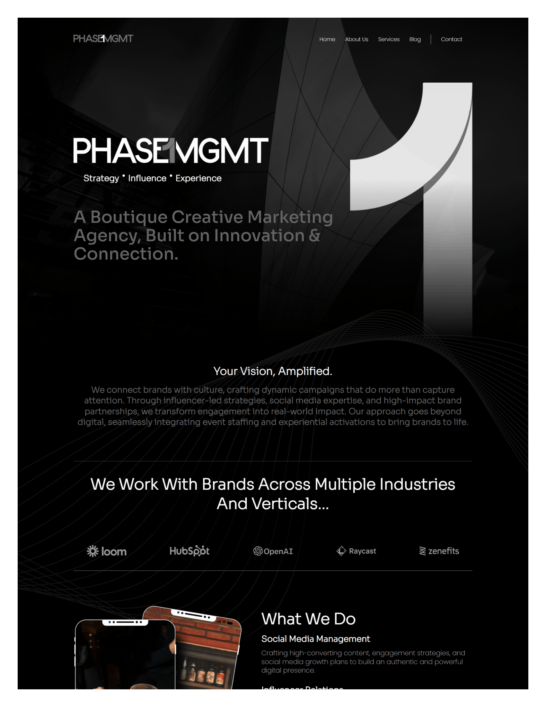
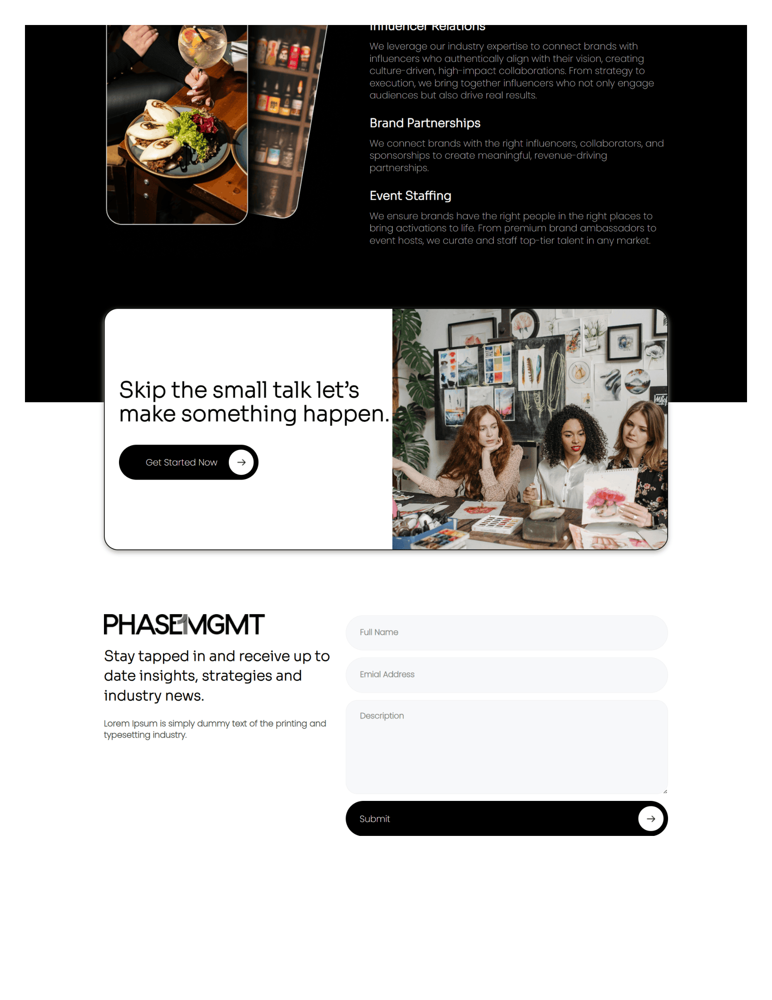

# Phase1MGMT Website Replica

<p align="center">
  
</p>

<p align="center">
  
</p>

<p align="center">
  A front-end recreation of the Phase1MGMT website using HTML5 and CSS3.
</p>

<p align="center">
  
  
  
</p>

## 📌 About the Project

This project is an independent front-end recreation of the **Phase1MGMT website**, developed to practice web development and improve my ability to reproduce an existing website's visual design using HTML and CSS.

The project focuses on recreating the layout, typography, imagery, navigation, and overall visual appearance of the original website.

> **Disclaimer:** This is an unofficial replica created for educational and portfolio purposes. It is not affiliated with, endorsed by, or developed by Phase1MGMT.

## ✨ Features

- Modern, dark-themed website interface
- Navigation bar inspired by the original website
- Hero section with background imagery and prominent typography
- Brand logo showcase
- Marketing services section
- Call-to-action section
- Contact form interface
- Custom typography using Poppins and Sora fonts
- CSS hover effects and visual styling

## 🛠️ Technologies Used

| Technology | Purpose |
|---|---|
| HTML5 | Website structure and content |
| CSS3 | Styling, layouts, typography, and effects |

## 📂 Project Structure

```text
Modern-website-UI/
├── index.html
├── style.css
├── Phase1MGMT-UI-Screenshots-1.png
├── Phase1MGMT-UI-Screenshots-2.png
└── assets/
    ├── fonts/
    └── images/
```

## 🚀 Getting Started

### Prerequisites

- A modern web browser
- Visual Studio Code (optional)

### Installation

**1. Clone the repository**

```bash
git clone https://github.com/DanishKummar/Modern-website-UI.git
```

**2. Navigate to the project folder**

```bash
cd Modern-website-UI
```

**3. Run the website**

Open `index.html` in your browser.

Alternatively, open the project in Visual Studio Code and use the Live Server extension to run it locally.

> If your GitHub repository has a different name, replace the repository URL and folder name above with the correct ones.

## 🎯 Project Objectives

- Strengthen HTML and CSS skills through practical implementation.
- Practice translating an existing website design into code.
- Improve understanding of layout, spacing, typography, and visual hierarchy.
- Build practical projects for my web development portfolio.

## 🔮 Future Improvements

- Improve responsiveness across mobile, tablet, and desktop screens.
- Make navigation links functional.
- Connect the contact form to a form-handling service or backend.
- Optimize images and page loading performance.
- Deploy the website and add a live demo link.

## 👨‍💻 Author

**DanishKummar**

- **GitHub:** [@DanishKummar](https://github.com/DanishKummar)
- **Email:** [danishkummar25@gmail.com](mailto:danishkummar25@gmail.com)
- **LinkedIn:** [Danish Kumar](https://www.linkedin.com/in/danish-kumar-859b4a283/)

---

⭐ Thanks for checking out my project!

If you have feedback or suggestions, feel free to connect with me on GitHub or LinkedIn.
